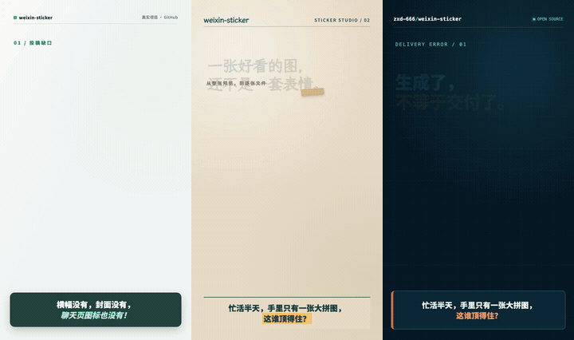
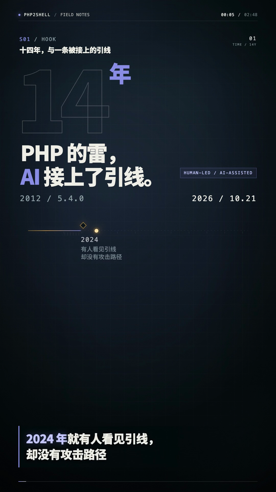
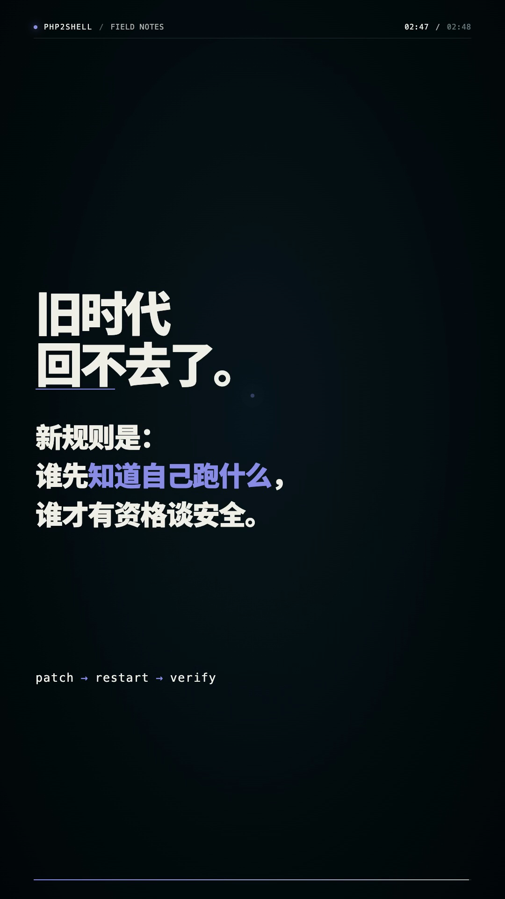

# Video Flow

从主题或文稿，制作有来源、能讲清楚、可继续修改的中文讲解视频。**先调研和确认文案，再确定声音与视觉风格，最后用代码制作成片。**

本仓库是 Codex Skill 的规则与参考文档，不是输入标题就自动导出 MP4 的独立程序。每支视频的工程、素材和成片由 Skill 在任务中创建，渲染后端按本机环境选择。本项目公开源码，**允许按许可非商用使用、修改和分享；商用需单独授权**。

## 效果示例

### 三种风格的视频片段

同一个 [weixin-sticker 项目](https://github.com/zxd-666/weixin-sticker)主题，用代码分别制作了三种视觉方向。下方并排动图可以直接比较画面运动；点击动图可打开 **30 秒视频示例**。完整视频按顺序展示 **1 清爽纪实（00:00–00:10）→ 2 纸感拼贴（00:10–00:20）→ 3 深色技术台（00:20–00:30）**。这是配乐字幕风格样片，不是三支完整成片。

[](https://github.com/zxd-666/video-flow/blob/main/examples/style-showcase.mp4)

[查看 30 秒 MP4](https://github.com/zxd-666/video-flow/blob/main/examples/style-showcase.mp4) · [下载 MP4](https://raw.githubusercontent.com/zxd-666/video-flow/main/examples/style-showcase.mp4) · [查看高清静态对比图](examples/style-showcase-cover.png)

### 完整讲解视频的画面示例

下面两帧来自另一轮本地端测：主题是“AI 辅助研究者发现 PHP 安全问题”，选择 **B 真人演说（API 配音）+ 3 深色技术台**。开场用时间轴建立问题，结尾回到判断与行动。图片是代码制作的视频画面截图；完整测试视频含第三方网页截图，其公开复用条件仍需核查，因此不随本仓库分发。

<p>
  
  
</p>

这只是一个已选风格的实例。真实来源截图、解释机制的动画、字幕和声音会随当次脚本重新设计。

## 适合什么任务

- **资讯解读**：核实近期事件，把“发生了什么、为什么重要、去哪看原文”讲清楚。
- **产品或开源项目介绍**：结合仓库、文档和实际界面说明用途、工作方式与适用边界。
- **技术讲解**：用流程、对比、代码或数据可视化解释概念，保留事实依据。
- **已有文稿的视频化**：先核对易变事实，再把长稿改成适合观看的镜头与字幕。

画面以 HTML/CSS/SVG/Canvas/GSAP 等代码编排和渲染。可使用有来源的网络图片、用户素材或 AI 生成的**静态图片**；不使用 AI 生成视频镜头，也不把模拟画面冒充真实证据。配音是可选分支，不要求真人出镜。

## 三步工作流

| 阶段 | 做什么 | 交给用户看什么 | 进入下一步的条件 |
| --- | --- | --- | --- |
| 1. 调研与写稿 | 搜索并核实新近事实；同步保存可能入镜的原始网页截图、图片与出处；写有段落 ID 的完整脚本 | 核心判断、逐段文案、事实来源、画面意图、视觉证据目录 | 脚本交付审阅 |
| 2. 确认方案 | 修改文案；选择声音形式和视觉风格 | 确认版脚本，以及明确的声音与风格选择 | **文案、声音形式、视觉风格都已明确** |
| 3. 制作与验收 | 写导演方案和逐镜头表；制作声音、代码画面、字幕；渲染并检查实际 MP4 | 视频、字幕或屏幕文案、可编辑工程、素材与来源清单、验证结果 | 成片可播放，关键内容和声画检查完成 |

审稿前可以保存调研取得的真实资料，**不提前生成配音、AI 图片、动画工程或视频**。用户回复“ok”只确认文案；若声音或风格尚未选定，还需补齐这两项。选好风格后直接做逐镜头方案，不强制做三版视觉样片。

### 声音形式

| 选项 | 观看体验 | 制作时如何定时间 |
| --- | --- | --- |
| **A 配乐字幕** | 无人声；背景音乐、音效和屏幕短句承担讲解 | 按实际阅读时间、画面动作与音乐节拍安排 |
| **B 真人演说（API 配音）** | 用语音 API 生成人声旁白，可配低音量音乐；不等于真人出镜 | 先试听开头与技术词，再用最终音频安排镜头和字幕 |

选择 B 需要可用且获授权的语音 API。普通文本模型接口不等于语音合成接口；API 的能力、价格和许可要在使用时核查。**个人声音克隆须另有声音样本使用授权**，不能从旧视频中自行提取。没有可用配音服务时，不会悄悄改成系统 TTS 或纯配乐。

### 视觉风格

| 编号 | 名称 | 特征 | 常见适用内容 |
| --- | --- | --- | --- |
| **1** | 清爽纪实 | 浅色留白、清晰排版、真实截图与克制动效 | 资讯、产品介绍、证据展示 |
| **2** | 纸感拼贴 | 暖纸材质、图片与物件的拼贴和拆分运动 | 案例、创意、具象叙事 |
| **3** | 深色技术台 | 深色界面、流程线、局部放大、代码和工具画面 | 技术、安全、开源项目 |

可以指定自己的风格或组合。风格决定整体视觉语言；**每一镜仍要按正在讲的内容设计**，不能整片重复同一种知识卡片动画。

## 完整调用示例

以下展示对话和产物的形状。文案片段与文件名是说明用的示意；实际事实、来源、用词和时长以当次调研、确认稿和最终音频为准。

**1. 给主题。** 不需要先写完整制作简报。

> `$video-flow` 做一支讲解视频：AI 辅助研究者发现 PHP 安全问题。面向短视频平台，开头要有情绪钩子，结尾告诉观众去哪里看原始资料、应该检查什么。

**2. 审调研稿。** Skill 会给出完整可念的内容稿、每段的依据和候选入镜证据。下面是表达形式的节选，属于示意文案：

```text
核心判断：AI 能加快安全研究，但发现、验证、修复仍需分清责任与证据。

S01 开场钩子
  文案：兄弟们，AI 把老代码里的安全问题重新翻出来了。
        真正该问的不是它有多神，而是：问题怎么被验证，我们又该去哪核对影响？
  画面意图：时间轴上标出问题出现、研究与修复的关键节点。
  来源映射：A01 官方公告；A02 原始研究说明。

S02 事实与机制
  文案：发现线索只是起点。要判断风险，得看利用条件、受影响版本和修复说明。
  画面意图：真实公告截图出现后，切到代码绘制的过程示意。

S03 结尾干货
  文案：如果你维护 PHP 服务，先去官方安全公告核对版本，
        再看你所用发行版或供应商的修复说明；别只凭一个标题判断自己是否安全。
  画面意图：让资料名称、入口和检查动作在手机画幅中可暂停阅读。
```

关键断言会关联直接来源、发布日期或事件日期、适用范围。候选截图则有资产 ID、原始 URL、获取时间、对应段落、许可或待核事项。**网页截图只能证明“这个页面在截图时这样显示”，不能代替事实核验。**

**3. 确认稿件和形式。** 例如回复：

> 文案确认，选 **B + 3**。技术词先试听，声音自然一点；结尾保留原始资料入口。

这意味着选 API 人声和“深色技术台”。确认后才进入配音、镜头设计和渲染。如果只说“文案 OK”，Skill 会继续询问尚未选择的声音或风格。

**4. 制作与交付。** 逐镜头表会把讲解内容和画面动作一一对应：

| 段落 | 观众此刻要理解什么 | 画面动作示例 | 素材与声音 |
| --- | --- | --- | --- |
| S01 | 为什么这件事值得听 | 时间轴逐步显出关键节点，标题随情绪落点出现 | 代码画面；人声开场 |
| S02 | 原始信息说了什么 | 先展示保留标题与出处的真实截图，再聚焦关键段落 | 有来源的截图 `A01`；字幕跟随语义 |
| S03 | 下一步去哪看、做什么 | 资料入口与行动要点分层出现，留足阅读时间 | 代码排版；结尾旁白 |

真人演说版先获得最终旁白音频，再依其实际停顿确定统一时间线；配乐字幕版则按屏幕短句的阅读时间排镜头。渲染后检查声画同步、字幕、关键画面、来源展示与结尾可读性。

一次典型任务的交付目录可能如下，**不是本仓库自带的文件**：

```text
video-project/
├── script.md                  # 确认版文案，保留 S01… 段落 ID
├── research.md                # 关键事实与直接来源
├── research/
│   ├── evidence-index.md      # A01… 证据资产、出处与使用状态
│   └── assets/                # 调研原件；发布前逐项检查使用条件
├── treatment.md               # 导演方案与视觉母题
├── timeline.*                 # 镜头、字幕、音频的共同时间线
├── scenes/                    # 可编辑的代码画面
├── audio/                     # 最终旁白或音乐与音效
├── captions.srt               # 口播字幕；配乐版可交屏幕文案文件
└── out/
    └── final.mp4              # 已检查的成片
```

### 另一种输入：已有文稿

> `$video-flow` 把这份产品介绍稿做成 9:16 视频，选 **A 配乐字幕 + 1 清爽纪实**。先核实版本和产品能力，给我审稿；确认后再制作。

这一路径仍会先审稿。配乐字幕版会从确认内容提炼可读的屏幕短句，不把长段文稿直接塞进画面。

## 研究、素材与事实边界

- 对新闻、版本、产品能力、价格、人物、法规和其他易变信息，优先核对原始公告、官方文档、论文或原始数据；记录资料发布日期与事件发生日期。搜索摘要不能直接当来源。
- 调研时及时留存**可能入镜**的真实页面或原始文件，并建立证据索引。真实截图用于展示资料现场；过程或内部机制用代码绘制并在需要时标“示意”。
- 区分已核实事实、解释性推断和个人判断。开头可以有情绪，不能因此夸大影响范围或把“尝试”说成“确认成功”。
- 结尾要给观众带得走的信息：原始资料在哪里、先看哪部分，以及与主题直接相关的 1–3 个检查或判断动作。
- 第三方截图、图片、音乐和字体在发布前应核对来源、署名和使用条件。调研时保存了候选素材，不代表已经取得公开传播权。

## 安装与使用

需要支持本地 Skill 的 Codex 环境。本仓库根目录本身就是 Skill 目录；`SKILL.md` 是入口，调用名为 `$video-flow`。先获取仓库，再在仓库根目录安装：

```bash
git clone https://github.com/zxd-666/video-flow.git
cd video-flow
mkdir -p "$HOME/.codex/skills/video-flow"
rsync -a --exclude='.git/' --exclude='examples/' ./ "$HOME/.codex/skills/video-flow/"
```

如果安装目录已有独立副本，修改本仓库后要重新同步，才会影响该副本。`rsync` 会更新目标目录的同名文件，执行前先检查目标中是否有自己的改动。

画面制作需要本机可用的代码渲染工具。Skill 会优先检查已安装的 `huashu-motion` 后端及其 `om` CLI；不可用时，应说明缺口并选择可验证的代码渲染路径。API 配音只在选 B 时需要；MiniMax 的接入边界见 [配音参考](references/minimax-voice.md)，其他服务也须核查当前官方能力与授权。

## 仓库结构

```text
video-flow/
├── SKILL.md                       # 入口：流程、放行点与完成标准
├── README.md                      # 本文：面向使用者的说明与示例
├── LICENSE                        # 配置和未来代码的非商用许可
├── LICENSE-CONTENT.md             # 文档与示例媒体的非商用许可及范围
├── agents/openai.yaml             # Codex 展示与调用元数据
├── references/
│   ├── research-and-script.md     # 调研、证据索引、脚本和审稿
│   ├── production-and-qa.md       # 导演方案、制作、验收与交付
│   └── minimax-voice.md           # MiniMax 配音的可选接入边界
└── examples/                      # 三种风格的视频、动态预览、封面与端测截图
```

`references/` 按阶段读取：研究时看研究文档，文案与方案确认后才看制作文档；选择 MiniMax 配音时才需要相应接入说明。视频工程和成片应放在每次任务的独立目录，不要把一次测试的输出当作 Skill 的固定依赖。

## 验证、凭据与发布状态

修改 Skill 后，可在仓库根目录做结构检查：

```bash
python3 ~/.codex/skills/.system/skill-creator/scripts/quick_validate.py .
```

这个检查只验证 Skill 结构，不等于视频已完成。真实视频还需检查 MP4 可播放、画幅和时长、音频轨、字幕可读性、段落与画面的关系，以及关键来源是否正确呈现。可用时按制作后端执行静态检查、抽帧、渲染与 QA，并实际观看和试听。

付费 API Key 只在运行时从系统密钥管理器或已注入的进程环境读取；**不要写入本仓库、视频工程、命令文本、日志或交付包**。`.gitignore` 只是辅助，提交前仍需检查新增文件。确认本地制作不等于授权购买服务、克隆个人声音、上传或发布视频。

## 许可

| 文件范围 | 许可 | 可以做什么 |
| --- | --- | --- |
| `README.md`、`SKILL.md`、`references/`、`examples/` | [CC BY-NC 4.0](LICENSE-CONTENT.md) | 非商用使用、改编和分享；分享时注明作者、许可和修改情况 |
| `agents/openai.yaml`、`.gitignore`、未来新增的代码与配置 | [PolyForm Noncommercial 1.0.0](LICENSE) | 按许可进行非商用使用、修改和分发；保留许可与 Required Notice |

商用应先取得权利人的单独授权。项目中的外部链接、被引用的第三方素材和用户自行制作的视频，不会因为这个仓库的许可而自动获得相同授权；发布视频时仍需逐项核查。

“禁止商用”与 [OSI 的开源软件定义](https://opensource.org/osd)不兼容，因此这里准确称为**源码公开、非商用许可**，不标作 OSI 开源软件。公开仓库地址：[zxd-666/video-flow](https://github.com/zxd-666/video-flow)。
